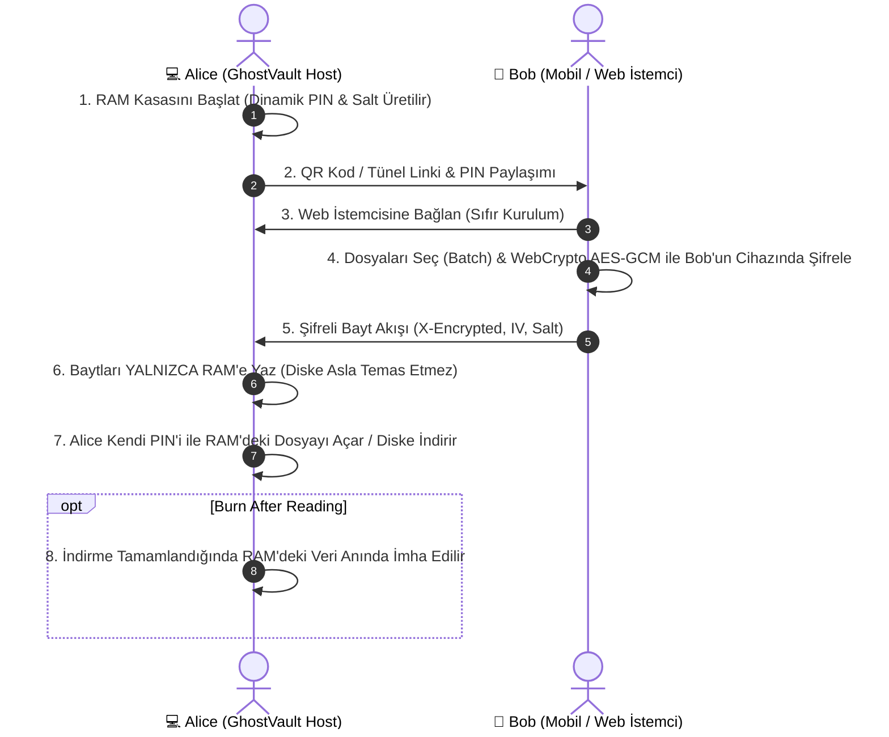

# GhostVault 🛡️⚡

> **Zero-Knowledge Ephemeral RAM Safe & Cross-Network P2P Bridge**  
> *Sıfır Disk İzi Bırakan, RAM Tabanlı ve Uçtan Uca Şifreli Dosya / Grup Aktarım Sistemi*

[](https://flutter.dev)
[](https://dart.dev)
[](https://en.wikipedia.org/wiki/Galois/Counter_Mode)
[](#ephemeral-architecture)
[](#cross-network-tunnel)
[](LICENSE)

---

## 🚀 Proje Hakkında (About GhostVault)

**GhostVault**, geleneksel dosya transfer araçlarının ve bulut depolama servislerinin yarattığı güvenlik açıklarını kökten çözmek için tasarlanmış yüksek güvenlikli bir dosya aktarım ve geçici kasa sistemidir.

Geleneksel dosya aktarımında:
- Dosyalar üçüncü taraf sunucularda depolanır.
- Disk üzerinde kalıcı manyetik ve adli bilişim (forensic) izleri kalır.
- Farklı ağlardaki cihazlar için karmaşık Port Yönlendirme (Port Forwarding), CGNAT veya güvenlik duvarı engelleri çıkar.

**GhostVault Çözümü:**
1. **%100 Uçucu Bellek (RAM-Only):** Dosyalar diske asla yazılmaz. Uygulama kapandığında veya elektrik kesildiğinde tüm veriler geri döndürülemez biçimde yok olur.
2. **Sıfır Bilgi & Uçtan Uca Şifreleme (Zero-Knowledge E2EE):** İstemci tarafında Web Crypto API & Dart Crypto ile AES-256-GCM ve dinamik PBKDF2 tuzu ile şifrelenir. Sunucu bile şifreyi çözemez.
3. **Grup / Toplu Dosya Aktarımı (Batch Transfer):** Telefonda ve bilgisayarda tek tek uğraşmak yerine onlarca dosyayı aynı anda seçip canlı aktarım yüzdeleriyle grup halinde gönderebilirsiniz.
4. **Sıfır Port Tüneli (Cloudflare Quick Tunnel):** Router ayarı yapmadan, modem portu açmadan farklı ağlardaki (mobil veri, farklı Wi-Fi) cihazlar tek tıkla bağlanır.
5. **Kendini İmha Eden Notlar (Burn-After-Reading):** Bir kez indirildiğinde veya okunduğunda RAM'den anında parçalanan (shredding) gizli notlar ve dosyalar.
6. **Masaüstü P2P Köprüsü:** İki GhostVault kurulu bilgisayar arasında doğrudan güvenli tünel veya yerel ağ köprüsü.

---

## 🌟 Temel Yetenekler (Key Features)

| Özellik | Açıklama |
| :--- | :--- |
| **🛡️ E2EE AES-256-GCM** | Askeri düzeyde kimlik doğrulamalı şifreleme. PIN olmadan ağ trafiğini dinleyenler yalnızca anlamsız baytlar görür. |
| **⚡ Grup Dosya Aktarımı** | Telefon web arayüzünde ve Windows masaüstünde çoklu dosya seçimi ve sıralı akış kuyruğu. |
| **🔥 Burn After Reading** | `Tek okumada imha et` seçeneğiyle indirme sayacı dolan veri anında RAM'den bellek üzerine yazılarak silinir. |
| **🌐 Sıfır Port Tüneli** | CGNAT ve modem kısıtlamalarını aşan otomatik TLS korumalı Cloudflare tüneli. |
| **📱 Sıfır Kurulum Web İstemcisi** | Telefona hiçbir uygulama kurmaya gerek yoktur. QR kod okutulduğunda fütüristik Web Crypto SPA tarayıcı belleğine yüklenir. |
| **📡 Bağımsız Ağ Seçici** | Wi-Fi, Ethernet veya Hotspot (Hava Boşluğu / Air-Gapped) ağ kartları arasında anında geçiş. |
| **🖥️ P2P Masaüstü Köprüsü** | İki bilgisayar arasında PIN doğrulamalı uzak kasa senkronizasyonu. |

---

## 🏗️ Mimari & Güvenlik Akışı (Architecture)



---

## 💻 Kurulum & Çalıştırma (Getting Started)

### Gereksinimler
- Flutter SDK (>= 3.24.0)
- Dart SDK (>= 3.5.0)
- Windows 10/11 (Masaüstü için)

### Projeyi Klonlama & Bağımlılıkları Yükleme
```bash
git clone https://github.com/ysf-06/GhostVault.git
cd GhostVault
flutter pub get
```

### Windows Masaüstü Sürümünü Derleme
```bash
flutter build windows --release
```
Derlenen çalıştırılabilir dosya `build/windows/x64/runner/Release/ghost_vault.exe` yolunda oluşur.

---

## 📱 Kullanım Senaryosu (How to Use)

1. **Kasayı Başlatın:** GhostVault'u çalıştırın. Kasanız rastgele güvenli 6 haneli bir PIN ve dinamik PBKDF2 tuzu ile açılır.
2. **Ağ Modunu Seçin:**
   - **Aynı Ağdaysanız (Ev/Ofis Wi-Fi):** Yerel IP ve port üzerinden doğrudan bağlanın.
   - **Farklı Ağlardaysanız (Mobil Veri / Dış Ağ):** "Farklı Ağlar İçin Sıfır Port Tüneli" anahtarını açın.
3. **QR Kodu Okutun:** Telefondan QR kodu okutun. Şık, karanlık temalı web arayüzü anında açılır.
4. **Grup Halinde Dosya Gönderin:** Birden fazla fotoğraf, video veya doküman seçin; `Kasaya Fırlat` butonuna basın.
5. **İmha Edin:** İşi biten dosyaları tek tıkla RAM'den imha edin.

---

## 🔒 Güvenlik Bildirimi (Security Notice)

GhostVault, verileri yalnızca geçici bilgisayar belleğinde (RAM) tutar. Bilgisayar kapatıldığında veya uygulama sonlandırıldığında veriler kalıcı olarak silinir ve manyetik plakalarda veya SSD çiplerinde hiçbir adli (forensic) iz kalmaz.

---

## 📄 Lisans

Bu proje [MIT Lisansı](LICENSE) kapsamında lisanslanmıştır. Açık kaynak dünyasına ve güvenli iletişime katkı sağlaması amacıyla geliştirilmiştir.

---
**Geliştirici:** Yusuf Karatay ([@ysf-06](https://github.com/ysf-06))
