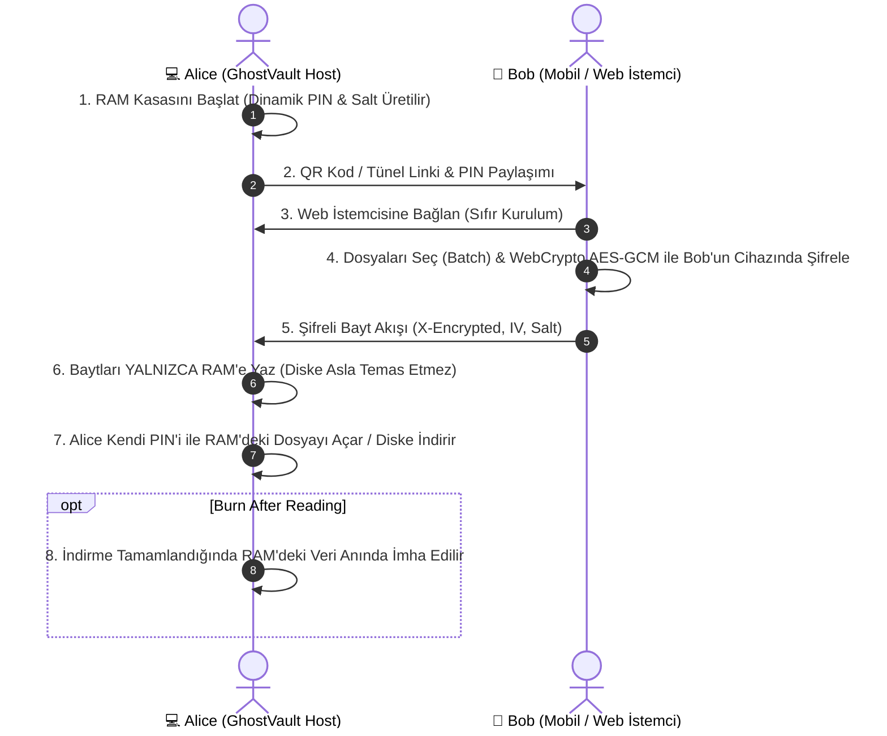

# GhostVault 🛡️⚡

> **Zero-Knowledge Ephemeral RAM Safe & Cross-Network P2P Bridge**  
> *Sıfır Disk İzi Bırakan, RAM Tabanlı ve Uçtan Uca Şifreli Dosya / Grup Aktarım Sistemi*

[](https://flutter.dev)
[](https://dart.dev)
[](https://en.wikipedia.org/wiki/Galois/Counter_Mode)
[](#ephemeral-architecture)
[](#cross-network-tunnel)
[](LICENSE)

---

## 🚀 Proje Hakkında (About GhostVault)

**GhostVault**, geleneksel dosya transfer araçlarının ve bulut depolama servislerinin yarattığı güvenlik açıklarını kökten çözmek için tasarlanmış yüksek güvenlikli bir dosya aktarım ve geçici kasa sistemidir.

Geleneksel dosya aktarımında:
- Dosyalar üçüncü taraf sunucularda depolanır.
- Disk üzerinde kalıcı manyetik ve adli bilişim (forensic) izleri kalır.
- Farklı ağlardaki cihazlar için karmaşık Port Yönlendirme (Port Forwarding), CGNAT veya güvenlik duvarı engelleri çıkar.

**GhostVault Çözümü:**
1. **%100 Uçucu Bellek (RAM-Only):** Dosyalar diske asla yazılmaz. Uygulama kapandığında veya elektrik kesildiğinde tüm veriler geri döndürülemez biçimde yok olur.
2. **Sıfır Bilgi & Uçtan Uca Şifreleme (Zero-Knowledge E2EE):** İstemci tarafında Web Crypto API & Dart Crypto ile AES-256-GCM ve dinamik PBKDF2 tuzu ile şifrelenir. Sunucu bile şifreyi çözemez.
3. **Grup / Toplu Dosya Aktarımı (Batch Transfer):** Telefonda ve bilgisayarda tek tek uğraşmak yerine onlarca dosyayı aynı anda seçip canlı aktarım yüzdeleriyle grup halinde gönderebilirsiniz.
4. **Sıfır Port Tüneli (Cloudflare Quick Tunnel):** Router ayarı yapmadan, modem portu açmadan farklı ağlardaki (mobil veri, farklı Wi-Fi) cihazlar tek tıkla bağlanır.
5. **Kendini İmha Eden Notlar (Burn-After-Reading):** Bir kez indirildiğinde veya okunduğunda RAM'den anında parçalanan (shredding) gizli notlar ve dosyalar.
6. **Masaüstü P2P Köprüsü:** İki GhostVault kurulu bilgisayar arasında doğrudan güvenli tünel veya yerel ağ köprüsü.

---

## 🌟 Temel Yetenekler (Key Features)

| Özellik | Açıklama |
| :--- | :--- |
| **🛡️ Doğrulanmış AEAD (AES-256-GCM)** | 128-bit bütünlük etiketli AEAD şifreleme. PIN olmadan ağ trafiğini dinleyenler anlamsız baytlar görür; tahrif edilmiş veri anında reddedilir. |
| **⚡ Grup Dosya Aktarımı** | Telefon web arayüzünde ve Windows masaüstünde çoklu dosya seçimi ve sıralı akış kuyruğu. |
| **🔥 Burn After Reading** | `Tek okumada imha et` seçeneğiyle indirme sayacı dolan veri anında RAM'den bellek üzerine yazılarak silinir. |
| **🌐 Sıfır Port Tüneli** | CGNAT ve modem kısıtlamalarını aşan otomatik TLS korumalı Cloudflare tüneli. |
| **📱 Sıfır Kurulum Web İstemcisi** | Telefona hiçbir uygulama kurmaya gerek yoktur. QR kod okutulduğunda fütüristik Web Crypto SPA tarayıcı belleğine yüklenir. |
| **📡 Bağımsız Ağ Seçici** | Wi-Fi, Ethernet veya Hotspot (Hava Boşluğu / Air-Gapped) ağ kartları arasında anında geçiş. |
| **🖥️ P2P Masaüstü Köprüsü** | İki bilgisayar arasında PIN doğrulamalı uzak kasa senkronizasyonu. |
| **🔐 Uç Nokta Erişim Denetimi** | `/api/files`, `/api/upload`, `/api/download`, imha ve panik uç noktalarında zorunlu `X-Vault-PIN` doğrulaması. |
| **⏱️ Akıllı Hız Sınırlayıcı (Rate Limiting)** | Kaba kuvvet (brute-force) saldırılarına karşı 5 başarısız denemede 5 dakika otomatik IP dondurma. |
| **🛡️ Bellek Taşma Koruması** | RAM tükenmesi ve DoS saldırılarına karşı 500 MB akış ve yükleme boyutu sınırı. |

---

## 🏗️ Mimari & Güvenlik Akışı (Architecture)



---

## 💻 Kurulum & Çalıştırma (Getting Started)

### Gereksinimler
- Flutter SDK (>= 3.24.0)
- Dart SDK (>= 3.5.0)
- Windows 10/11 (Masaüstü için)

### Projeyi Klonlama & Bağımlılıkları Yükleme
```bash
git clone https://github.com/ysf-06/GhostVault.git
cd GhostVault
flutter pub get
```

### Windows Masaüstü Sürümünü Derleme
```bash
flutter build windows --release
```
Derlenen çalıştırılabilir dosya `build/windows/x64/runner/Release/ghost_vault.exe` yolunda oluşur.

---

## 📱 Kullanım Senaryosu (How to Use)

1. **Kasayı Başlatın:** GhostVault'u çalıştırın. Kasanız rastgele güvenli 6 haneli bir PIN ve dinamik PBKDF2 tuzu ile açılır.
2. **Ağ Modunu Seçin:**
   - **Aynı Ağdaysanız (Ev/Ofis Wi-Fi):** Yerel IP ve port üzerinden doğrudan bağlanın.
   - **Farklı Ağlardaysanız (Mobil Veri / Dış Ağ):** "Farklı Ağlar İçin Sıfır Port Tüneli" anahtarını açın.
3. **QR Kodu Okutun:** Telefondan QR kodu okutun. Şık, karanlık temalı web arayüzü anında açılır.
4. **Grup Halinde Dosya Gönderin:** Birden fazla fotoğraf, video veya doküman seçin; `Kasaya Fırlat` butonuna basın.
5. **İmha Edin:** İşi biten dosyaları tek tıkla RAM'den imha edin.

---

## 🔒 Güvenlik Mimarisi & Doğrulama (Security Architecture)

GhostVault, yüksek güvenlikli geçici veri paylaşımı için çok katmanlı savunma (Defense-in-Depth) prensibiyle tasarlanmıştır:

1. **Uçucu Bellek Mimarisi (RAM-Only Volatile Storage):** Veriler diske kalıcı olarak kaydedilmez. Oturum sonlandığında veya panik butonu tetiklendiğinde bellek serbest bırakılır.
2. **Doğrulanmış AEAD Şifreleme (AES-256-GCM):** Galois/Counter Mode ve 12-byte IV kullanılarak şifrelenen veriler, 128-bit kimlik doğrulama etiketiyle korunur. Bozulmuş veya değiştirilmiş paketler derhal reddedilir.
3. **Sertleştirilmiş API Uç Noktaları:** `/api/status` yanıtında PIN gibi hassas veriler asla ifşa edilmez. Tüm veri okuma, yükleme ve silme uç noktaları `X-Vault-PIN` başlığı veya onaylı belirteç gerektirir.
4. **Kaba Kuvvet (Brute-Force) Koruması:** 5 başarısız yetkilendirme denemesinden sonra istemci IP adresi 5 dakika süreyle kilitlenir (HTTP 429).
5. **Bellek Taşırma (DoS) Sınırı:** Tekil yüklemeler 500 MB ile sınırlandırılarak RAM tükenmesi ve hizmet engelleme riskleri engellenir.
6. **Güvenli Tünel İletişimi:** OpenSSH fallback'inde `StrictHostKeyChecking=accept-new` kuralı uygulanarak ortadaki adam (MITM) saldırılarına karşı koruma sağlanır.

### 🔏 İkili Dosya Bütünlük Doğrulaması (SHA-256 Verification)
GhostVault v1.1.0 `GhostVault_Setup.exe` resmi SHA-256 sağlama değeri:
```text
e0e989b9c627bb353e2748c952ff31d08189f5f5cc208161b535036b1c682882
```
İndirdiğiniz kurulum dosyasının bütünlüğünü doğrulamak için PowerShell'de şu komutu çalıştırabilirsiniz:
```powershell
Get-FileHash -Algorithm SHA256 .\GhostVault_Setup.exe
```

---


---

## 🛡️ Güvenlik Uyarıları & Kurulum Sorun Giderme (Security & False Positives Guide)

GhostVault, **%100 açık kaynak kodlu** ve şeffaf bir projedir. Tüm kaynak kodları bu depoda denetlenebilir durumdadır. Ancak indirme sırasında işletim sistemleri tarafından aşağıdaki uyarılar verilebilir:

### 🪟 Windows: SmartScreen & Antivirüs Bildirimleri (False Positive)
- **Neden Çıkar?**
  1. **İmzasız Yazılım (Unsigned Binary):** Açık kaynaklı bir proje olduğu ve binlerce liralık yıllık kurumsal kod imzalama sertifikası (EV Code Signing) satın alınmadığı için Microsoft SmartScreen henüz tanınmayan dosyaları "bilinmeyen yayımcı" olarak işaretler.
  2. **Sezgisel Algılama (Heuristics):** GhostVault'un yerel HTTP sunucusu açması ve dahili tünel motoru barındırması, bazı antivirüs yazılımlarının sezgisel motorlarında yanlış alarm (False Positive) üretebilir.
- **Nasıl Çözülür?**
  - **"Windows kişisel bilgisayarınızı korudu" (SmartScreen):**
    1. Ekrana gelen mavi kutuda **"Ek bilgi" (More info)** bağlantısına tıklayın.
    2. Sağ alttaki **"Yine de çalıştır" (Run anyway)** butonuna tıklayın.
  - **Tarayıcı Uyarısı (Chrome / Edge "Zararlı olabilir"):**
    - İndirilenler listesinde dosyanın yanındaki `...` menüsünden **"Sakla" (Keep)** -> **"Yine de sakla"** seçeneğini seçin.

---

### 🍎 macOS: Gatekeeper & "Uygulama Doğrulanamıyor" Bildirimleri
- **Neden Çıkar?**
  - Apple Gatekeeper, Apple Developer kimliğiyle ($99/yıl) noter tasdiki (Notarization) yapılmamış tüm üçüncü taraf açık kaynak uygulamaları varsayılan olarak engeller.
- **Nasıl Çözülür?**
  - **Yöntem 1 (Sağ Tık ile Aç - En Kolay):**
    1. Uygulama simgesine çift tıklamak yerine **Sağ Tıklayın (Control + Tıklama)**.
    2. Açılan menüden **"Aç" (Open)** seçeneğine basın ve onay penceresinde tekrar **"Aç"** deyin.
  - **Yöntem 2 (Sistem Ayarları):**
    1. **Sistem Ayarları** -> **Gizlilik ve Güvenlik** menüsüne gidin.
    2. Sayfanın altındaki Güvenlik bölümünde *"GhostVault engellendi"* uyarısının yanındaki **"Yine de Aç" (Open Anyway)** butonuna tıklayın.
  - **Yöntem 3 ("Hasar görmüş / Çöp sepetine taşıyın" uyarısı için Terminal):**
    ```bash
    sudo xattr -rd com.apple.quarantine /Applications/GhostVault.app
    ```

---

### 🌐 English: Security Warning & Installation FAQ

#### Windows SmartScreen Prompt ("Windows protected your PC"):
1. Click **"More info"**.
2. Click **"Run anyway"**.
*Why:* GhostVault is free and open-source. It does not carry a $500/yr enterprise EV code-signing certificate, causing Windows SmartScreen to flag it until reputation is built.

#### macOS Gatekeeper Prompt ("Cannot be opened because developer cannot be verified"):
1. **Right-click** (or Control-click) `GhostVault.app` -> Select **"Open"** -> Click **"Open"** again.
2. Alternatively, navigate to **System Settings** -> **Privacy & Security** -> Click **"Open Anyway"**.
3. If macOS says the app is damaged due to quarantine attributes, execute:
   ```bash
   sudo xattr -rd com.apple.quarantine /Applications/GhostVault.app
   ```

## 📄 Lisans

Bu proje [MIT Lisansı](LICENSE) kapsamında lisanslanmıştır. Açık kaynak dünyasına ve güvenli iletişime katkı sağlaması amacıyla geliştirilmiştir.

---
**Geliştirici:** Yusuf Karatay ([@ysf-06](https://github.com/ysf-06))
